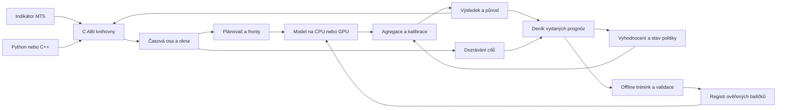

# Architektura predikční knihovny pro MT5 a samostatné aplikace

Návrh třetí verze k 17. listopadu 2026, výchozí vydání DLL 2.3.0. Prvním produktem má být hodinový indikátor, který pro příštích šest obchodních svíček vykreslí poslední ověřený odhad ceny a bodová predikční pásma. Totéž jádro, vstupní data a balíček vah musí dát stejnou prognózu v MT5 i v samostatné aplikaci. Datum vydání prognózy, dostupnost dat, horizont a verze modelu jsou součástí výsledku.

**Doporučená první sestava** je predikce poslední ceny, empirická pásma upravená podle volatility, CPU runtime a neblokující rozhraní. Ridge, dnešní LSTM/GRU a malá kauzální TCN poběží nad stejnými vstupy jako porovnávaní kandidáti. Model smí převzít konkrétní výstup, až když porazí příslušnou referenci. Je například možné nasadit lepší interval a přitom pro střed křivky ponechat poslední cenu. Pilot AUDUSD za rok 2024 odůvodňuje tuto opatrnost konkrétním výsledkem. Na šest hodin nepřekonala poslední cenu žádná ze tří inicializací TCN ani ze tří hlavních běhů LSTM/GRU. [Původní pilot, latence a audit DLL](NAVRH_PREDIKCI.cs.md)

## Co z aktuálních studií přenést do knihovny

| Práce a druh důkazu | Zjištění v rozsahu dat autorů | Rozhodnutí pro projekt |
| --- | --- | --- |
| Filippou, Rapach, Taylor a Zhou, recenzovaný článek zveřejněný online 4. 11. 2026 | Na **měsíčních** USD kurzech deseti rozvinutých ekonomik v období 1995–2020 získali predikční informaci z interakce fundamentů a globálních finančních podmínek. Síla některých vztahů rostla při vyšší globální FX volatilitě. | Režim volatility měřit z již známé historie. Vliv režimu na H1 testovat odděleně. Pro případné fundamenty vyžadovat datum zveřejnění a tehdy dostupnou revizi. [Článek v JFQA](https://www.cambridge.org/core/journals/journal-of-financial-and-quantitative-analysis/article/economic-fundamentals-and-shortrun-exchange-rate-prediction-a-machinelearning-perspective/CDC0098EA9A18DB84D02F84899711227) |
| Kilic, pracovní studie Fedu, revize září 2026 | U osmi USD párů překonávala silně regularizovaná nelineární regrese v některých nastaveních běžnou regresi. Srovnání s náhodnou procházkou vyšlo ve prospěch modelu jen u části měn a záviselo na sadě fundamentů. | Uvádět vždy výsledek proti poslední ceně, lineárnímu modelu i aktuálně nasazenému modelu. Samostatně vyzkoušet variantu s konstantou a bez ní, aby zachycený průměrný drift nezakryl malou směrovou informaci. [Pracovní studie FEDS](https://www.federalreserve.gov/econres/feds/virtue-or-mirage-complexity-in-exchange-rate-prediction.htm) |
| Maehashi, Miyakawa a Sasaki, Bank of Japan, pracovní studie z 29. 5. 2026 | Pro velké týdenní pohyby USD/JPY pomohly v jejich modelu ukazatele rozdílných očekávání účastníků, odvozené z jednotlivých transakcí s FX opcemi v registru obchodů. | Opční data mohou jednou rozšířit predikci krajních pohybů. Balíček modelu musí uvádět poskytovatele, frekvenci a čas dostupnosti. Běžný graf MT5 takovou informaci sám nedodává. [Studie a datové omezení](https://www.boj.or.jp/en/research/wps_rev/wps_2026/wp26e10.htm) |
| FinVerse, preprint, verze z 23. 10. 2026 | V porovnání 43 předtrénovaných modelů se pořadí podle finančního benchmarku a obecného GIFT-Eval shodovalo jen mírně až středně (`r = 0,43`). Pořadí se měnilo s typem řady a metrikou. | Kandidáta vybírat samostatně pro výnos, pravděpodobnost růstu a pásmo daného trhu. Cross-sectional ranking má význam až pro produkt, který vybírá mezi aktivy. [FinVerse v3](https://arxiv.org/abs/2608.03259v3) |
| Noguer i Alonso a Pereira Franklin, preprint z června 2026 | Na pěti amerických akciích předtrénované modely často vyhrávaly mezi porovnávanými sítěmi. Statisticky přesvědčivá převaha nad náhodnou procházkou se v jejich testu objevila jen u dvou kombinací modelu a akcie. | Přidat jeden pevně verzovaný předtrénovaný model jako offline referenci. Evidovat uzávěru předtrénování. Výhodu ověřit na pozdějších kotacích cílového brokera. [Studie o výnosech pěti akcií](https://arxiv.org/abs/2606.27100) |

První dvě práce se liší ve specifikaci modelu, výběru měn i prediktorech. Pro vývojáře z toho plyne ověřitelný experiment. Stejné měnové vstupy vyhodnotit s interakcí s předem známou globální volatilitou i bez ní, zveřejnit výsledky po časových řezech a spočítat, zda k rozhodnému okamžiku byly všechny příznaky vůbec dostupné. Pro první vydání mají přednost pozorovatelné veličiny z MT5.

## Co má model odhadovat

Označme `F_t` informaci skutečně dostupnou při vydání prognózy a `R_h = log(C[t+h]/C[t])` budoucí kumulativní výnos při shodném typu ceny. Pro bodovou předpověď `f` platí rozklad `E[(R_h−f)²] = E[Var(R_h | F_t)] + E[(E[R_h | F_t]−f)²]` pro konečný druhý moment a předpověď měřitelnou vzhledem k `F_t`. Pokud je podmíněný průměr blízko nule, zůstává pro zlepšení MSE málo prostoru. Podmíněný rozptyl se přitom může měnit výrazně. Tato matematická vlastnost odůvodňuje samostatné produkty a samostatné testy jejich přínosu.

| Výstup pro každé `h` | Referenční model | Hodnocení a zobrazení |
| --- | --- | --- |
| Střed | Nulový výnos, dále ridge s minulými výnosy | MSE pro podmíněný průměr výnosu, MAE pro medián. Pro cenu zakreslit `C[t] × exp(medián výnosu)`. Exponenciála průměrného výnosu obecně nedává očekávanou cenu. |
| Pravděpodobnost růstu | `p=0,5` a zvlášť četnost růstu odhadnutá z minulosti | Událost `R_h>0`, shoda cen znamená 0. Brierovo skóre `(p−y)²`, kalibrační tabulka s počty a intervaly nejistoty. Pravděpodobnost, že pohyb pokryje spread, je jiná událost s vlastním cílem. |
| Kvantily 0,10 / 0,50 / 0,90 | Historické kvantily a kvantily reziduí přepočtené na současnou volatilitu | Pinball loss pro každý kvantil, intervalové skóre, pokrytí a šířka po seancích. Kalibrace pracuje s jednotlivými horizonty. 80% pásmo pro každou svíčku nemá automaticky 80% pokrytí celé křivky. |
| Budoucí realizovaná variance | Sezónní profil, EWMA, po dodání jemnějších dat také HAR-RV | Cílová proxy `RV = Σ r_i²` z uzavřených dílčích intervalů budoucího horizontu. Uvést jejich frekvenci, typ ceny a zacházení s mezerami. Pro kladnou predikci `v` použít např. QLIKE `log(v) + RV/v` a hodnotit stejné realizace. |

Pinball loss pro kvantil `q` je `(y−f) × (q−1[y<f])`. Podporuje model i tehdy, když je užitečný jen odhad rozmezí. Gneiting a Raftery rozlišují kalibraci a ostrost prediktivního rozdělení. Corsi ukazuje smysl skládání volatility z několika časových měřítek. Patton stanovuje podmínky, za nichž jsou některé ztrátové funkce vhodné při použití nepřesné proxy volatility. Pro hodinový model je potřeba porovnat frekvence podkladových výnosů a zvlášť publikovat výsledky při rozšířeném spreadu. [Gneiting a Raftery](https://sites.stat.washington.edu/raftery/Research/PDF/Gneiting2007jasa.pdf) · [Corsi, HAR-RV](https://statmath.wu.ac.at/~hauser/LVs/FinEtricsQF/References/Corsi2009JFinEtrics_LMmodelRealizedVola.pdf) · [Patton, porovnání predikcí volatility](https://public.econ.duke.edu/~ap172/Patton_vol_proxies_JoE_2011.pdf)

### Ověření šestihodinové variance na stejném trhu

Pro AUDUSD jsem samostatně testoval součet čtverců **šesti následujících hodinových logaritmických výnosů**. Je to hrubá proxy budoucí realizované variance. Z let 2023–2024 jsem odhadl konstantu a průměrný čtverec výnosu podle hodiny uzavření v UTC. Každou hodinovou skupinu jsem vyhladil dvaceti pozorováními o celkovém průměru. Ve vyhodnocení roku 2025 EWMA s koeficientem 0,94 přijímá poslední známý čtverec výnosu. Kombinovaná varianta nejprve odstraní hodinovou sezónnost a odhadnutou úrovní přepočte součet sezónních variancí příštích šesti hodin. Po časové mezeře se průběžná úroveň inicializuje na historickou referenci. U všech metod jsou stejné původy a realizace. [Reprodukční skript](research/variance_h1.py)

| Model variance | Rozdíl QLIKE proti konstantě | Přibližný 95% párový interval |
| --- | ---: | --- |
| Sezónnost podle hodiny UTC | −0,0536 | [−0,0828, −0,0277] |
| Samotná EWMA | −0,0880 | [−0,3112, +0,0565] |
| Sezónnost a EWMA | −0,1733 | [−0,3950, −0,0364] |

Z 6 172 vydaných předpovědí bylo možné spočítat **5 848** úplných realizací, 320 jich zasáhlo do mezery a čtyři za konec roku. Počty se liší od experimentu směru, protože tento model používá jen AUDUSD a potřebuje kratší souvislou vstupní historii. Záporný rozdíl QLIKE je příznivý. Jednotkou výsledku je rozdíl skóre, procentní výnos z něj odvodit nelze. Intervaly používají 2 000 společných bootstrapových výběrů z 53 týdenních bloků.

**Sezónnost je první silnější reference pro novou knihovnu.** Proti ní vyšla kombinace sezónnosti a EWMA o 0,1198 bodu lépe, ale párový interval [−0,3212, +0,0040] zahrnuje nulu. Přínos proměnlivé variance proti konstantě tedy stojí za test na IC Trading. Přidaná složitost nad samotnou sezónností si zaslouží další období. Budoucí cenové pásmo navíc musí samostatně prokázat pokrytí a šířku. Reprodukce z kořene projektu používá `python docs/research/variance_h1.py --cache tmp`.

### Síť a její rozšiřování

První vícekanálová TCN má vstup `[B,96,F]`, projekci do 16 nebo 32 kanálů, šest reziduálních bloků s jednou kauzální konvolucí o šířce 3 a dilatacemi 1, 2, 4, 8, 16, 32. Receptivní pole 127 zahrne všech 96 kroků. Každý kanál volitelného trhu doprovází maska dostupnosti a stáří poslední kotace. Ze stejné poslední reprezentace vede přímá hlava na horizonty 1–6. Pro kvantily parametrizovat dolní a horní vzdálenost od mediánu pomocí `softplus`. Tréninkové váhy jednotlivých úloh vybrat ve vnitřních časových řezech a porovnat se samostatně trénovanými hlavami. Horší úloha nemá připravit lepší úlohu o nasazení. [Původní práce o kauzálních TCN](https://arxiv.org/abs/1803.01271)

Každý model deklaruje úlohy, jednotky, přesné horizonty a požadované kanály. Volba mezi vlastním DAG, ONNX a nativním referenčním modelem patří do balíčku. Model s pouhými třemi kvantily neposkytuje obecně přesné `P(R_h>0)`. Pravděpodobnost se smí publikovat z ověřené pravděpodobnostní hlavy nebo z úplné prediktivní distribuční funkce `1−F_h(0)`. Pokud se budou kombinovat celá rozdělení, smísit distribuční funkce stejných měrných jednotek a kvantily vypočítat až z výsledku. Report zachytí i rozpory mezi zvlášť trénovanou hlavou směru a pásmy.

## Dvě využití teorie her

**Mikrostruktura a rozdílná informovanost.** V modelu Glostena a Milgroma dealer stanovuje různé očekávané hodnoty aktiva po nákupním a po prodejním pokynu. Spread může vzniknout samotnou výhodou lépe informovaných protistran. Cont, Kukanov a Stoikov na událostech knihy objednávek 50 amerických akcií našli souvislost mezi krátkodobým pohybem ceny, nerovnováhou nabídky a poptávky a hloubkou knihy. Jde o jiný trh a jejich vztah k probíhajícímu pohybu sám nedokazuje předpověď další hodiny. První adaptér proto používá skutečný bid/ask a příznak dostupnosti. Volitelný adaptér hloubky potřebuje posloupnost událostí konkrétního místa obchodování a vlastní časové testy. Tickové volume jedné CFD kotace není pozorování globálního toku příkazů v OTC FX. [Glosten a Milgrom](https://doi.org/10.1016/0304-405X(85)90044-3) · [Cont, Kukanov a Stoikov](https://arxiv.org/abs/1011.6402) · [MetaQuotes, struktura ticku](https://www.mql5.com/en/docs/constants/structures/mqltick) · [MetaQuotes, hloubka trhu](https://www.mql5.com/en/docs/marketinformation/marketbookget)

**Opakovaná hra předpovědi s experty.** Před výsledkem vydá každý kandidát pravděpodobnost `p_i`. Knihovna publikuje `p = Σ w_i p_i`. Až dozraje skutečný výsledek `y`, aktualizuje `w_i ← w_i exp(−η (p_i−y)²)` a váhy normalizuje. Ztráta je v intervalu [0,1], je konvexní a lze ji spočítat pro každého dostupného experta ze stejné realizace. Při jednotném začátku, úplné okamžité zpětné vazbě, pevných `K` expertech a `T` kolech platí pro součet ztrát směsi proti nejlepšímu pevnému expertovi horní mez `ln(K)/η + ηT/8`. Je to mez **relativní kumulativní ztráty**. Všechny modely mohou společně odhadovat trh špatně. Záruku nelze beze změn přenést na neohraničenou MSE výnosů, měnící se experty nebo účetní zisk. [Freund a Schapire](https://www.schapire.net/papers/FreundSc95.pdf) · [Cesa-Bianchi a Lugosi](https://homes.di.unimi.it/~cesabian/predbook/)

Pro šestihodinovou prognózu se překrývá až šest nevyhodnocených kol. V pilotu použít šest nezávislých sad vah podle hodiny UTC modulo šest. V jedné sadě se před novou prognózou nejprve vyhodnotí poslední splatné kolo. Na kolech s kompletními cíli lze sčítat meze jednotlivých sad. Zpožděný nebo chybějící výsledek označit. Vynechaná realizace může být systematická, proto vedle skóre vykazovat i dostupnost. Pro živé **obchodní svíčky** použít čítač cílového obchodního kalendáře a skutečný čas doručení výsledku. Při mimořádně pozdních výsledcích stav fronty evidovat a ověřit chování samostatně. [Joulani, György a Szepesvári, zpožděná zpětná vazba](https://proceedings.mlr.press/v28/joulani13.html)

Simulátor strategických účastníků bych zvažoval až pro pozdější modul provedení pokynu. Pro predikci z OHLC chybějí protistrany, jejich soukromé informace, fronta objednávek i doložená funkce užitku. V přehrávači lze přímo otestovat rozšířený spread, opožděné NZDUSD, uzavření trhu se zlatem, výpadek kotací a skok při znovuotevření. U každého scénáře vykázat dostupnost a ztrátu.

### Experiment s předpovědí směru na rok 2025

Před otevřením výsledků jsem zvolil pravděpodobnost růstu AUDUSD za šest souvislých hodin UTC, tři experty a `η=0,1`. První expert dává 50 %, druhý odhaduje četnost podle šestihodinové části dne, třetí podle znamének posledních šestihodinových změn AUDUSD a NZDUSD. Tabulky četností používají 11 174 realizací z let 2023–2024 a vyhlazení odpovídající dvaceti neutrálním pozorováním. Tabulky zůstávají během hodnocení pevné. Výstup roku 2025 se do vah promítne nejdříve při jeho splatnosti. Cena beze změny se počítá jako nenárůst. [Datový archiv odvozený z kotací Dukascopy](https://huggingface.co/datasets/Yllvar/fx-historical-data) · [Reprodukční skript](research/delayed_experts.py)

| Metoda | Průměrné Brierovo skóre, nižší je lepší |
| --- | ---: |
| Neutrálních 50 % | 0,25000000 |
| Historická četnost podle části dne | 0,25049866 |
| Historická četnost podle směrů AUDUSD a NZDUSD | 0,25005468 |
| Pevný průměr tří expertů | **0,24996900** |
| Adaptivní váhy Hedge | 0,24997353 |

Vzniklo **5 896** předpovědí. U **5 578** dozrál úplný cíl, u 314 chyběla souvislá šestihodinová cílová řada a čtyři zasahovaly za konec roku. Rozdíl Hedge minus pevný průměr je **+0,00000453**, s přibližným 95% párovým intervalem **[−0,00001146, +0,00002051]** z 2 000 bootstrapových výběrů po 53 kalendářních týdnech. Jde o jeden archiv, jednu událost a jednu pevnou konfiguraci. Tento pokus nepodporuje zapnutí adaptivních vah jako výchozí politiky. Období 2025 je odteď vývojový důkaz a po úpravě expertů vyžaduje nové konečné ověření.

Pro kontrolu časové posloupnosti jsem změnil všechny ceny po 1. červenci 2025 00:00 UTC. Dříve dozrálých **2 751** výsledků i natrénované četnosti vyšly shodně. Reprodukce používá původní kontrolní součty souborů, Python, NumPy a DuckDB. Z kořene projektu spusťte `python docs/research/delayed_experts.py --cache tmp`.

## Moduly a datový tok

| Navržený modul | Vstup, výstup a vlastník stavu | Vazba na dnešní repozitář |
| --- | --- | --- |
| `adapters/mt5` a `bindings` | Indikátor vlastní graf, časovač a terminálové čtení. Python/C++ umí předat stejnou dávku časových událostí. Volající může po úspěšném odeslání své pole okamžitě použít znovu. | Nová dvojice importů a indikátoru vedle [stávajícího CrossAsset](../MQL5/Indicators/LSTM_CrossAsset_Forecast.mq5). |
| `core/events` a `core/features` | Události nesou zdroj, symbol, druh ceny, čas tržní události, čas dostupnosti a pořadí revize. Normalizace, masky, stáří, časové spojení napříč symboly a kruhové buffery vytvoří neměnné vstupní okno. Sdílenou implementaci volá živý běh i historické přehrávání. | Převzít principy uzavřených svíček a škálování z [přípravy řad](../python/financial_series.py). Doložit shodu na svátcích, DST a mezerách. |
| `runtime/scheduler` a `providers` | Plánovač vlastní rezervované sloty a krátké fronty. Poskytovatel disponuje neměnnými vahami, vlastním pracovním prostorem a dokončovací událostí. V první etapě CPU reference a adaptér DLL 2.3. Následují ONNX CPU a volitelný ONNX CUDA. | Nativní výpočet využije [existující vrstvy](../kernel.cu#L2819). Současná DLL drží měnitelný stav, takže adaptér musí vlastní handle obsluhovat sériově. |
| `forecast/policy` a `forecast/calibration` | Výstup obsahuje verzi modelu, uzamčenou verzi vah expertů a kalibrátoru, typ predikce a stav po horizonech. Politika má zprvu jednoho vybraného kandidáta na úlohu. Ověřené alternativy jsou pevný průměr, následně Hedge pro Brierovo skóre. | Dnešní pevný násobek reziduální RMSE má vlastní označení. Na pravděpodobnostní pásmo lze přejít po měření pokrytí. |
| `evaluation/ledger` a `evaluation/replay` | Deník spojí vydanou prognózu s přesnou cenou původu, okamžikem vydání a pozdější realizací. Z tohoto jediného toku čtou metriky, váhy expertů a případná rekalibrace. Všechny aktualizace jsou idempotentní podle ID prognózy, horizontu, účelu a verze politiky. | Rozšířit prospektivní CSV v indikátoru o samostatný strukturovaný deník. CSV zůstává lidsky čitelným exportem. |
| `research` a `model_registry` | Samostatný offline proces sestaví data podle času dostupnosti, trénuje, provádí časové řezy a exportuje model, transformace, kalibraci, metriky a referenční tenzory. Registr vydá neměnný balíček a bod návratu k předchozí verzi. | Přirozené vstupy jsou [stávající Python klient](../python/mql5gpu.py), [pilot na H1](research/audusd_h1_pilot.py) a existující kontrola nativních checkpointů. |

### Smlouva dat, času a vydání

- **Vstup.** `Observation` obsahuje `source_id, symbol_id, timeframe, price_basis, event_time_utc, available_at_utc, revision, values, valid_mask`. Časová vazba vybere pouze události dostupné v okamžiku rozhodnutí. Pokud historie dodání chybí, režim zpětného testu explicitně zaznamená předpoklad a zopakuje se s větším zpožděním. Pro OHLC bez ask použije model vyžadující pouze danou cenovou stranu. U kovů a FX se ověřuje obchodní seance každého zdroje zvlášť.
- **Příklad.** V 10.00 UTC se zavřela hodinová svíčka AUDUSD. Pokud její tick dorazí v 10.00.01 a poslední potvrzený údaj NZDUSD až v 10.00.04, může profil s povinným NZDUSD vydat odhad nejdříve ve druhém okamžiku. Profil vytrénovaný s maskami smí vydat starší známý vstup se skutečným stářím. Při pozdější opravě se původní vydaná křivka ponechá v deníku. Nový výpočet dostane revizi.
- **Výstup.** `Forecast` nese `forecast_id, origin, issued_at, model_generation, policy_version, calibration_version, price_basis, horizon_calendar`, seznam horizontů, bodové odhady, meze, volitelné pravděpodobnosti, příznaky kvality a stáří vstupů. Počty a pořadí řeší popis modelu. Nedostupná hodnota má vlastní příznak. Klient ji nemůže zaměnit za věcně správný nulový výnos.
- **Dozrání.** `Outcome` odkazuje na ID prognózy a skutečný horizont, cenu, čas přijetí a revizi. Vyhodnocení zaznamená `scored`, `missing`, `expired` nebo `right_censored`. Každý přijatý požadavek a každý publikovaný horizont mají dohledatelný konečný stav. Zpětná oprava kotace může vytvořit zvláštní přepočtený report. Online váhy v původním čase lze reprodukovat z původní posloupnosti událostí.
- **Balíček.** Verze schématu, kontrakt vstupů, seance a časové pásmo, okno, normalizace, mapa výstupů a jednotek, opset a seznam providerů, váhy, identita trénovacích dat, uzávěry dat a kalibrace, hashe souborů a referenční okna. Do živé relace se verze dostane až po kontrole tvarů, konečnosti hodnot a numerické shody s referencí. Změna sestavy expertů vyžaduje novou generaci politiky a kompatibilní počáteční stav.

Více grafů nebo klientů může odebírat tutéž prognózu. ID požadavku patří konkrétnímu klientovi. Kanonické ID prognózy se odvodí ze zdroje, symbolu, časové základny, původu, verze modelu a politiky a ze snímku vstupů. Jeden předem zvolený okamžik vydání na původ a horizont vstupuje do výuky vah jednou. Tím počet otevřených grafů ani pozdější revize jediné svíčky nezmění význam jejího výsledku pro učení. U starších modelů s výstupem `100 × log(C[t+h]/C[t])` adaptér před výpočtem ceny odstraní faktor 100 právě jednou.

### Rozhraní DLL a souběh

Navrhované exporty mají nový prefix `DN3_` a novou Windows x64 DLL. V2 nadále nabízí svých 45 exportů přes původní hlavičku. ABI v3 používá C linkage, celočíselné kódy, 64bitová ID, délky polí a předem definované rozložení výsledků. MQL5 používá primitivní argumenty a plochá pole předaná referencí. Python používá stejné volání přes `ctypes`. V této etapě jsou názvy návrhem. [Současná veřejná hlavička](../include/MQL5GPULibrary.h) · [Platný kontrakt 2.3](API.md)

| Operace | Smlouva |
| --- | --- |
| `GetAbiVersion / GetCapabilities` | Před otevřením modelu vrací verzi rozhraní a dostupné backendy. CPU sestavu musí jít načíst na čistém stroji bez CUDA. |
| `OpenRuntime / OpenSession / DescribeModel` | Otevře sdílený runtime procesu a relaci s limity front. Příprava vah a zahřátí jsou mimografová práce se stavem `LOADING → READY / FAILED`. Popis určuje tvar, layout, jednotky, horizonty a požadovanou velikost výsledku. |
| `Submit / TryRead` | `Submit` kopíruje vstup do vlastního slotu před návratem, přijímá klientské pořadové číslo a vrací ID. `TryRead` rozlišuje čekání, hotovo, malý buffer a koncové chyby. Při malém bufferu vrátí potřebnou délku a zachová výsledek pro další čtení. Žádné čekání na GPU ani I/O v těchto voláních. |
| `Cancel / Release / CloseSession / CloseRuntime` | Zrušení frontové práce je okamžité. U rozběhnutého kernelu je zrušení logické a slot se recykluje až po události dokončení. Uvolnění výsledku je bezpečné při opakování v rámci téže generace. Uzavření posledního runtime musí ukončit vlákna před vyložením DLL. Čas bezpečného vypnutí se měří odděleně od latence živých požadavků. |
| `GetJobError / GetMetrics` | Kód a text chyby jsou svázané s požadavkem. Zvlášť vracet počet sloučených požadavků, zaplnění fronty, neplatné vstupy, dobu čekání, přenos, běh modelu a čas připravenosti. Čas překreslení změří adaptér MT5. |

Jeden terminál sdílí plánovač mezi grafy. Živá fronta smí sloučit dosud nezahájená okna stejné relace a označit starší `SUPERSEDED`. Offline režim požadavek zachová nebo vrátí `QUEUE_FULL`. Požadavky různých vah nelze sloučit jen na základě shodného tvaru. Pro jeden graf se při volném zařízení začíná okamžitě. Na GPU se poolované buffery, dlouhodobá relace a I/O binding vyhodnotí vedle stejného modelu na CPU. Priorita tréninku se řídí změřenou p99 inference. Při poruše GPU lze přejít jen na předem ověřenou CPU variantu stejné generace, jinak vrátit chybu s posledním platným původem. [ONNX Runtime I/O binding](https://onnxruntime.ai/docs/performance/tune-performance/iobinding.html) · [CUDA provider](https://onnxruntime.ai/docs/execution-providers/CUDA-ExecutionProvider.html)

Politiku pro daný instrument a horizont aktualizuje jediná uspořádaná posloupnost událostí. Při `Submit` ukládat odkaz na neměnný snímek vah a kalibrace platný pro okamžik rozhodnutí. Dokončení GPU v odlišném pořadí tím nezmění vydané pravděpodobnosti. Nový balíček se načte a zahřeje vedle aktivního, pak se atomicky přepne generace. Zápis deníku obsluhuje vlastní ohraničená fronta. Vyžaduje-li profil auditovatelný výstup, zveřejní pracovní vlákno výsledek až po potvrzení trvalého zápisu. Při plné frontě vrátí konkrétní stav. Po restartu se uložený stav politiky obnoví spolu s polohou v deníku a následné události se přehrají jednou.

Indikátor uchovává poslední vykreslený původ pro každý horizont. Převzetí probíhá při události grafu nebo časovače. Zastaralý výsledek může být platný pro vyhodnocení v deníku, ale nesmí posunout křivku na novější svíčku. MT5 sdílí vlákno mezi indikátory stejného symbolu a při běžící obsluze další událost téhož časovače nezařazuje. [Vlákna v MQL5](https://www.mql5.com/en/docs/runtime/running) · [Pravidla časovače](https://www.mql5.com/en/docs/event_handlers/ontimer)

## Validace, vydání a pořadí práce

**Statistické přijetí.** Před laděním zamknout cílový instrument, horizont, metriku, časovou dostupnost a jednoduchou referenci. Trénink → výběr konfigurace → kalibrace → následující ověřovací blok se posouvají chronologicky. Na hranicích odstranit trénovací původy s cílem zasahujícím do další části. Roky 2024 a 2025 již figurovaly ve vývoji. Konečný test proto potřebuje dosud nepoužité období a následný prospektivní režim na IC Trading. Při větším počtu kandidátů použít například Model Confidence Set nad párovými ztrátami ve stejných časech, s časovým blokovým bootstrapem. Pokud zůstane několik nerozlišitelných kandidátů, rozhodnout podle pokrytí vstupů, kalibrace a ceny inference. Samotný výběr množiny modelů nedokazuje převahu nad referencí. [Hansen, Lunde a Nason](https://www.kevinsheppard.com/files/teaching/mfe/advanced-econometrics/Hansen_Lunde_Nason.pdf)

**Kalibrace za provozu.** Začít samostatným kalibračním obdobím pro každý horizont. Jako kandidáta až potom zkusit adaptivní konformní kalibraci reziduí. Na změnu pokrytí reaguje výhradně po dozrání skutečného cíle. Zaznamenat empirické pokrytí, šířku pásem a intervalové skóre po seancích a obdobích zvýšené volatility. Dlouhodobé průměrné pokrytí nezaručuje pokrytí v každém stavu trhu nebo jedné konkrétní svíčky. Opakování před kalibrací a po ní musí být měřeno na stejných vydaných prognózách. [Gibbs a Candès, ACI](https://arxiv.org/abs/2106.00170) · [Adaptace při distribučních posunech, JMLR](https://jmlr.org/papers/v25/22-1218.html)

| Pořadí | Co dodat | Jak se rozhodne o přijetí |
| --- | --- | --- |
| 1 | Časová osa, schéma výstupu, deník, přehrávač a predikce poslední ceny. Jeden klient MT5 a jeden Python. | Stejná posloupnost svíček a výstupů v obou klientech. Přejdou scénáře opravy kotace, výpadku seance, DST a restartu. Změna budoucích dat ponechá předchozí vydané výstupy identické. |
| 2 | Asynchronní C ABI. V první etapě testovat starou DLL v adaptéru a samostatnou lehkou CPU referenci. | Ověřit souběžné grafy, plnou frontu, opožděný výsledek, zrušení, malý výstupní buffer, změnu generace a bezpečné odpojení. Všech 45 exportů 2.3 a dosud podporované checkpointy projdou regresí. |
| 3 | Kvantilová a varianční reference, ridge, malá GRU a TCN, přenositelné ONNX balíčky. | Jediná implementace transformací, shoda na referenčních tenzorech mezi tréninkem, CPU a CUDA. Měřit síť se samotným cílem i s dalšími trhy. Profilovat i cenu konverzí. Pro neověřenou úlohu zůstane na grafu označená reference. |
| 4 | Nezávislé srovnání na brokerovi, průběžné skórování, stínové výstupy použitelných kandidátů. | Po horizontech vykázat zlepšení vůči referenci, nejistotu, šířku a pokrytí, četnost nevydaných prognóz. Samostatně vyhodnotit náklady a skluz, pouze pokud vznikne obchodní pravidlo. Hedge i adaptivní kalibraci zapnout až po vlastním testu přínosu. |
| 5 | Zátěžové testy, balíček pro čisté Windows x64, volitelný CUDA modul, instalační test MT5 i samostatné C/Python příklady. | Pro 1/8/32 grafů měřit p50/p95/p99, studený start, propustnost a RAM/VRAM. Počáteční cíle na sestavě Xeon E5-2680 v4 a RTX 3060 jsou p99 návratu z `Submit` do 0,5 ms, p95 hotové zahřáté predikce jednoho malého modelu do 10 ms a p95 překreslení po dostupnosti vstupů do 100 ms. Podmínky zahrnují nejméně 10 000 požadavků na konfiguraci a osmihodinovou zkoušku výměny modelů. Jde o návrhové cíle. |

**První rozhodovací bod** nastane, jakmile MT5 dokáže předat uzavřenou svíčku, vykreslit výsledek spočítaný mimo vlákno grafu a později k přesně této prognóze připojit skutečnou cenu. Stejný vstup musí projít samostatnou aplikací v Pythonu se shodným výsledkem. Teprve na této cestě lze spolehlivě porovnat rychlost, přesnost a dostupnost jednotlivých sítí.
