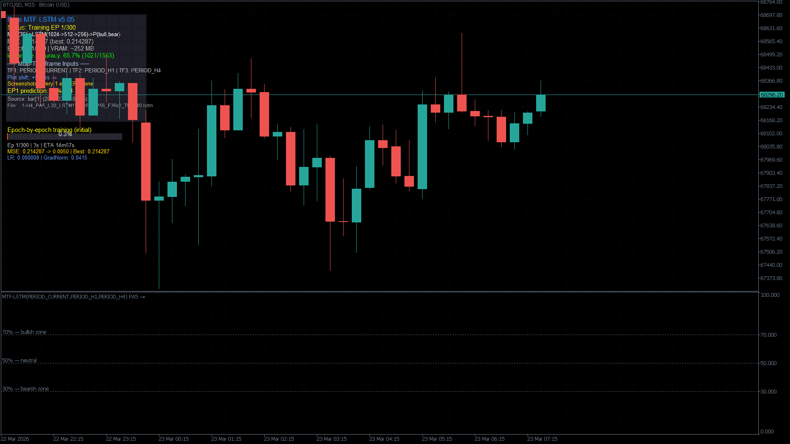

# MQL5GPULibrary_LSTM

CUDA neural networks for MetaTrader 5 and standalone Windows applications. Version **2.3.0** supports configurable acyclic graphs of **LSTM, GRU, tanh RNN, Dense and Identity** layers, branches, concatenation, residual sums and multiple outputs. AdamW, dropout, gradient clipping and asynchronous training retain the original sequential C ABI.

Author: **Tomáš Bělák** · [MIT license](LICENSE.txt) · [Česky](docs/README.cs.md)



## Cross-asset forecasts and manual

The new [LSTM_CrossAsset_Forecast](MQL5/Indicators/LSTM_CrossAsset_Forecast.mq5) indicator uses closed bars from the target chart and configurable predictor markets. Suggested starting setup: **AUDUSD H1**, with **NZDUSD, USDJPY and USDCAD** as drivers. Use the exact symbol names available on your IC Trading account. Commodities can also be selected; mismatched market sessions reduce synchronized history.

It trains a separate candidate asynchronously, uses train-only normalization and a purged chronological holdout, and draws six direct forecast horizons into the future. By default a candidate must beat the zero-return persistence baseline; otherwise the prior accepted model or a visibly gray baseline remains. Error bands are validation RMSE bands, not calibrated confidence intervals. No currency's forecastability or profitability is established by this example.

- [Comprehensive Czech PDF manual](docs/MQL5GPULibrary_Manual_cs.pdf) and [reviewable source](docs/MANUAL.cs.md).
- [Topology, data and deployment guide](docs/MANUAL.cs.md), including all indicator inputs and runtime dependencies.
- [Standalone CSV training](examples/train_csv.py) and [saved-model inference](examples/predict_csv.py), using the standard-library [Python client](python/mql5gpu.py).

Example topology string (one line):

```text
lstm:32:linear:0.10:concat:-1;gru:16:linear:0.10:concat:-1;dense:24:tanh:0:concat:0,1
```

Each node is `type:width:activation:dropout:merge:parents`. External input is `-1`; earlier nodes are zero-based. `concat` joins feature channels; `sum` requires equal widths. Dense activations are linear/tanh/relu/sigmoid. All nodes must reach the output. This supports arbitrary graphs of the listed operations, not unimplemented operations such as attention or convolution.

## Build and test

Requires **64-bit Windows**, Visual Studio 2022 with C++ tools, a compatible NVIDIA CUDA Toolkit, an NVIDIA GPU and driver, CMake 3.24+, and Python 3 for tests. The locally verified configuration is CUDA 13.0, MSVC 19.44 and RTX 3060 (compute capability 8.6).

```powershell
cmake -S . -B build -A x64 -DCMAKE_CUDA_ARCHITECTURES=86
cmake --build build --config Release --parallel 4
ctest --test-dir build -C Release --output-on-failure
```

Set `CMAKE_CUDA_ARCHITECTURES` for the deployment GPU. Output: `build/Release/MQL5GPULibrary_LSTM.dll`. The existing Visual Studio solution also supports Debug and Release DLL builds. See [build and verification instructions](docs/BUILDING.md) for CUDA version overrides, dependencies and CPU-only checks.

## Install in MT5

1. Build the DLL from this source revision and copy it to the terminal data directory, `MQL5/Libraries`.
2. Copy both files in `MQL5/Include/` to the terminal's `MQL5/Include`.
3. Copy the indicators and `MQL5/Scripts/LSTM_SmokeTest.mq5` into their corresponding terminal directories. `LSTM_Pure_MTF_EA.mq5` is an Expert Advisor; place it under `MQL5/Experts` when using it as an EA.
4. Make the CUDA runtime, cuBLAS and cuRAND DLLs available to the terminal, enable DLL imports, and compile the desired MQL5 source in MetaEditor.
5. Run `LSTM_SmokeTest` to verify synthetic-data training and prediction before using an indicator.

The smoke script and new cross-asset indicator make no trades. The older indicators and EA remain examples; model validation and trading performance are separate from library correctness. Generated DLL/EX5 files are local release artifacts. Build a package with `tools/package_release.ps1` after compiling MQL5 and building the PDF. The package includes `tools/Install-MT5.ps1`; its optional `-CopyCudaRuntime` copies CUDA 13 dependencies from your installed toolkit. The NVIDIA driver and Visual C++ x64 runtime remain prerequisites.

## API essentials

Use the shared [MQL5 include](MQL5/Include/MQL5GPULibrary.mqh) or [C header](include/MQL5GPULibrary.h). All original `DN_*` signatures are retained.

```cpp
int h = DN_Create();                         // positive handle, 0 on failure
DN_SetSequenceLength(h, 30);
DN_SetMiniBatchSize(h, 64);
DN_AddLayerEx(h, 8, 64, 0, 0, 0.10);        // 8 features; act=0 selects LSTM
DN_AddLayerEx(h, 0, 32, 0, 0, 0.05);        // infer input width from previous layer
DN_SetOutputDim(h, 2);
// Check every return value; allocate buffers before these calls:
// DN_LoadBatch(h, X, T, samples, 30*8, 2, 0);
// DN_TrainAsync(h, 100, 0.001, 0.0008, 0.0);
// Poll status/progress, then predict after training has finished.
DN_Free(h);
```

- Public inputs are flat sample-major doubles: `X[sample, timestep, feature]`. Targets and predictions are `[sample, output]`. Internal computation uses float32.
- `in = sequence_length * features`, `layout = 0`, `ln = 0`.
- `DN_AddLayerEx` selects **0=LSTM, 1=GRU, 2=RNN**. It does not select an activation function. Layer normalization is not implemented.
- `DN_Train` blocks. `DN_TrainAsync` returns after reserving the model for a worker.
- Prediction, mutation and serialization on a busy model return failure promptly. Progress, status, result polling and stop requests remain available.
- `DN_GetProgressAll` outputs **lr, mse, best_mse**, in that order after its four integer outputs.
- `DN_GetError` copies the last library error as UTF-16. Read it immediately after failure; the diagnostic is shared across handles.

See [the API contract](docs/API.md) for buffer lengths, lifecycle, state formats and migration notes.

## What is tested

Portable tests validate dimension overflow, graph/checkpoint parsing, leakage prevention and consistency of all 45 exported signatures across CUDA, C and MQL5. GPU tests exercise recurrent and branched graphs, CPU reference equations and numerical gradient norms, serialization rollback, asynchronous lifecycle and standalone CSV model save/reload. The new indicator and smoke test also compile in IC Trading MetaEditor with zero errors and warnings. See the [validation record](docs/VALIDATION.md) for tested scope and limitations.

GitHub Actions runs portable checks on Windows and Linux. GPU checks are an explicit workflow for a Windows runner labeled `cuda`; hosted CPU checks do not substitute for GPU verification.

## Repository map

| Path | Purpose |
| --- | --- |
| `kernel.cu` | CUDA kernels, recurrent layers, training and DLL exports |
| `src/graph_layers.cuh`, `include/topology.h` | Dense/Identity CUDA operations and graph validation |
| `include/` | C ABI, shared dimension validation and CPU checkpoint parser |
| `MQL5/Include/` | One shared DLL import declaration for all examples |
| `MQL5/Indicators/`, `MQL5/Scripts/` | MT5 examples and smoke test |
| `tests/`, `tools/check_api.py` | CPU, ABI and GPU regression checks |
| `docs/` | API, build and Czech usage documentation |
| `python/`, `examples/` | Standalone time-series pipeline without MT5 |
| `CMakeLists.txt`, `*.sln`, `*.vcxproj` | Build entry points |

[Changes](CHANGELOG.md) · [Contributing](CONTRIBUTING.md) · [Implementation guide](func_docu.md)


